<a href="https://github.com/arsalanbali2021-ux">
  
</a>

<p align="center">
  <a href="#accession-record">About</a> ·
  <a href="#selected-work">Work</a> ·
  <a href="#the-type-case">Toolkit</a> ·
  <a href="#how-i-work">How I work</a> ·
  <a href="#say-hello">Say hello</a>
</p>

## Accession record

Museums give every object a catalogue card. Here's mine.

```yaml
# accession record · AB-2026
name:       Arsalan Bali
findspot:   Mumbai, India  (IST, UTC+05:30)
role:       Student developer, frontend and full-stack
medium:     Python, JavaScript, HTML/CSS, SQL
works:      Script Atlas (digital epigraphy lab) · ValueTrack (personal finance app)
condition:  learning machine learning, one project at a time
open_to:    internships · project collaborations · heritage-tech ideas
```

## Selected work



**Script Atlas** is an Indian Knowledge Systems (IKS) project. You can step through real inscriptions in a seven-stage *Inscription Detective* workflow (observe, gather clues, identify the script, decode, interpret, verify, reflect), compare any two scripts side by side, and trace a 28-script Brahmic family tree. Readings are checked against museum records and published translations. The repository is private while it's in active development. I'm happy to give a walkthrough.

<p align="center">
  <a href="https://github.com/arsalanbali2021-ux/valuetrack"></a>
  
</p>

## The type case

Printers kept their letters in a wooden type case, one compartment per sort. These are mine.



<sub>Python · JavaScript · HTML5 · CSS3 · SQL · Flask · SQLAlchemy · MySQL · pandas · pytest · Canvas 2D · Node.js · Git · GitHub</sub>

## How I work

- **I write the decision down.** Script Atlas has architecture decision records and a full runtime-flow document, so the *why* survives longer than my memory of it.
- **I test before I ship.** 121 automated tests across 17 feature areas in Script Atlas, and pytest for ValueTrack's EMI and import logic.
- **I keep commits small and honest.** Conventional Commits (checked by a script), one purpose per branch, draft PRs that say what was tested and what wasn't.
- **I keep dependencies few.** Script Atlas runs fully offline on plain HTML, CSS and JavaScript. Fewer moving parts means it will still open in ten years.
- **I care whether it's correct.** A misread inscription or a wrong EMI is a real error, so I go back to the source before I trust the output.

## Say hello

<p>
  <a href="https://github.com/arsalanbali2021-ux?tab=repositories"><b>Browse my repositories →</b></a><br />
  <a href="https://github.com/arsalanbali2021-ux/valuetrack"><b>Read the ValueTrack source →</b></a><br />
  <a href="https://github.com/arsalanbali2021-ux/arsalanbali2021-ux/issues/new?title=Hello%20Arsalan"><b>Open an issue to say hi →</b></a>
</p>


